<div align="center">

# 🎨 Pixel Chroma

**2D 도트 색칠 숨바꼭질 · 최대 12인 Steam 멀티플레이**

*몸을 배경색으로 직접 칠해 숨는 **크로마**와, 물총으로 찾아내는 **술래**의 숨바꼭질*

[](https://unity.com/)
[](#)
[](https://github.com/MirrorNetworking/Mirror)
[](https://github.com/rlabrecque/Steamworks.NET)
[](https://github.com/Cysharp/UniTask)

[▶ 포트폴리오 영상 (YouTube)](https://www.youtube.com/watch?v=vdB4pgSr3JY) · [🛒 Steam 페이지](https://store.steampowered.com/app/5023800/)

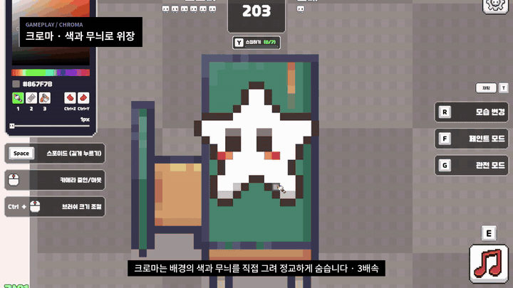 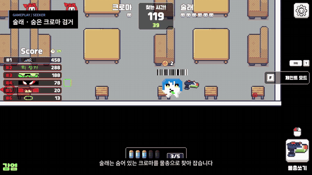

<sub>왼쪽: 크로마가 배경의 색과 무늬를 직접 그려 위장 (3배속) · 오른쪽: 술래가 물총으로 크로마를 찾아 전원 검거</sub>

</div>

<br>

## 📌 프로젝트 개요

| 항목 | 내용 |
| --- | --- |
| **장르** | 2D 도트 색칠 숨바꼭질 · 멀티플레이 (최대 12인) |
| **개발 형태** | 팀 프로젝트 (4인) |
| **개발 기간** | 2026.06.25 – 2026.09.10 (약 11주) |
| **개발 환경** | Unity 6 (6000.3.11f1), C#, URP |
| **네트워크** | Steam Lobby (Steamworks.NET) + Mirror + FizzySteamworks |
| **맡은 역할** | 클라이언트 개발 — **매칭 시스템, 플레이어 색칠 동기화, 픽셀 닉네임, 네트워크 트러블슈팅** |
| **목표** | 네트워크 환경을 직접 구축하고, 전용 서버 없이 동작하는 멀티플레이 게임을 완성하자! |

<br>

## 🎮 게임 소개

> 메챠카멜레온에서 영감을 받은 **2D 도트 버전 숨바꼭질**입니다.
> 도트 그래픽은 배경과 색을 정확히 맞추면 눈으로 찾기 거의 불가능하다는 점을 핵심 재미로 삼았습니다.

| 역할 | 플레이 |
| --- | --- |
| 🎨 **크로마** | 준비 시간 동안 팔레트에서 색을 골라 **자기 캐릭터를 픽셀 단위로 칠해** 배경에 숨습니다. 브러시 · 지우개 · 채우기를 지원합니다. |
| 🔫 **술래** | 배경에 녹아든 크로마를 의심되는 곳마다 **물총으로 쏴서** 찾아냅니다. 맞히면 즉시 검거됩니다. |
| ⚖️ **밸런스** | 단색으로 완벽하게 칠해도 캐릭터 외곽선에 **엠보싱(그림자 + 하이라이트)** 이 남아, 술래가 명암 경계를 단서로 쓸 수 있습니다. |

**승리 조건** — 술래: 제한 시간 안에 크로마 전원 검거 / 크로마: 제한 시간까지 생존
**게임 모드** — 기본 모드, 감염 모드 (잡힌 크로마가 술래로 전환)

<br>

## 🙋 담당 구현 요약

| # | 구현 내용 | 핵심 키워드 |
| :-: | --- | --- |
| 1 | [매칭 시스템 구현](#1-매칭-시스템-구현) | Steam Lobby + Mirror 역할 분리 · 4가지 입장 경로를 하나의 흐름으로 통합 |
| 2 | [매칭 품질 설계](#2-매칭-품질-설계) | 퀵 매칭 3초마다 조건 단계 완화 · 가까운 지역 · 같은 언어 우선 · 유령방 대응 |
| 3 | [플레이어 색칠 동기화](#3-플레이어-색칠--저장--동기화) | 원본과 분리된 마스크 1장 · 마스크 대신 입력만 전송 · 늦은 입장 청크 동기화 |
| 4 | [사용자 제작 픽셀 닉네임](#4-사용자-제작-픽셀-닉네임) | 60×12 픽셀 닉네임 · 편집용/전송용 키 분리 · 접속당 1회 업로드 |
| 🔥 | [트러블슈팅: 발사 무시](#-트러블슈팅--서버-지연으로-인한-발사-무시) | 지연 허용 오차 · 판정 기준 시각 보정 · 서버/클라 탄약 판정 일치 |

<br>

<p align="center">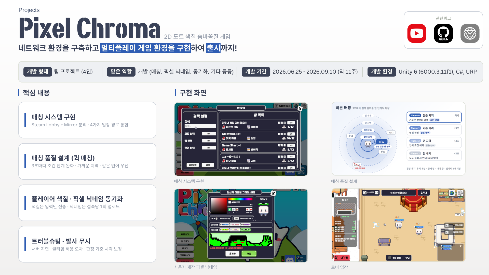</p>

---

## 1. 매칭 시스템 구현

> **Steam 로비를 매칭 계층으로 두고, 4가지 입장 경로를 하나의 `LobbyManager`로 통합**

<p align="center">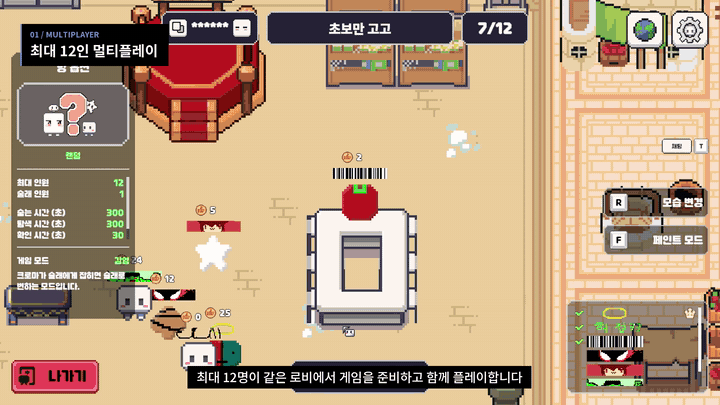</p>

### 시스템 구성

```
UI · 빠른 매칭 / 코드 매칭 / 로비 검색 / 로비 생성
        ↓ 요청                     ↑ OnLobbyFailed (실패 사유)
LobbyManager · 진입점 (생성 · 입장 · 방 상태)
   ├─ QuickMatchSearcher        ├─ RoomListSearcher
   ↓
Steam Lobby (매칭 · 메타데이터)  →  Mirror + FizzySteamworks (게임 패킷 통신)
```

- **입장 경로 일원화** — 빠른 매칭 · 코드 매칭 · 공개 로비 검색 · 친구 초대가 모두 `SteamMatchmaking.JoinLobby` → `OnLobbyEnteredCallback` 하나로 합류합니다. 콜백에서 로비 메타데이터의 `HostAddress`(호스트 SteamID)를 읽어 Mirror 클라이언트를 시작합니다.
- **메타데이터 하나로 검색과 표시를 통합** — `GameID · IsPublic · RoomStatus · RoomCode · GameMode · MapId · Language · HostAddress`
- **실패 사유 enum 일원화** — `LobbyFailureReason`을 각 입장 UI가 받아 다국어로 안내합니다.

### 네트워크 구조 — "만남"은 Steam, "통신"은 Mirror

| 계층 | 담당 | 역할 |
| --- | --- | --- |
| **만남 계층** | Steam Lobby · Steamworks.NET | 방 생성 · 공개 설정 · 인원 제한, 메타데이터 검색 · 필터 |
| **통신 계층** | Mirror · FizzySteamworks | SyncVar · Command · ClientRpc 동기화, **IP 대신 SteamID로 접속**, Steam 릴레이로 NAT 통과 · IP 비노출 |

두 계층은 `HostAddress (SteamID)` 하나로 연결되며, 호스트가 서버를 겸하는 **Listen Server 구조라 전용 서버 없이 동작**합니다.

### 왜 Steam + Mirror인가

| 구성 | 비용 | Steam 호환성 | 크로스플랫폼 |
| --- | --- | --- | --- |
| **Steam + Mirror** ✅ | 무료 | SteamID로 바로 접속 | ✗ Steam 전용 |
| EOS + Mirror | 무료 | EOS ID 연결 필요 | 지원 |
| Unity Relay + NGO | 사용량 과금 | UGS ID 별도 | 지원 |
| Photon Fusion | CCU 과금 | Photon ID 별도 | 지원 |

- **Steam 호환성**: SteamID가 곧 접속 주소라 별도 계정 체계 없이 로비 · 초대 · 접속을 하나로 처리
- **비용 0**: 호스트가 서버를 겸하고 Steam 릴레이는 무료 → 동시 접속자가 늘어도 서버 · 중계 비용 없음
- **확장 여지**: Mirror는 전송 계층이 분리돼 있어, 크로스플랫폼이 필요하면 Transport만 교체 (동기화 코드 유지)
- **트레이드오프**: Steam 전용이지만, Steam 단독 출시 기획이라 영향 없음

<details>
<summary>📑 포트폴리오 슬라이드 보기 (매칭 시스템 · 네트워크 구조 · 선택 이유)</summary>
<br>
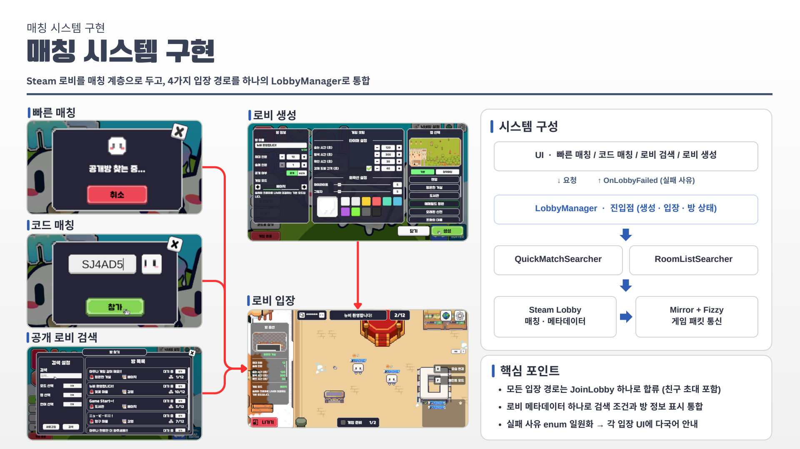
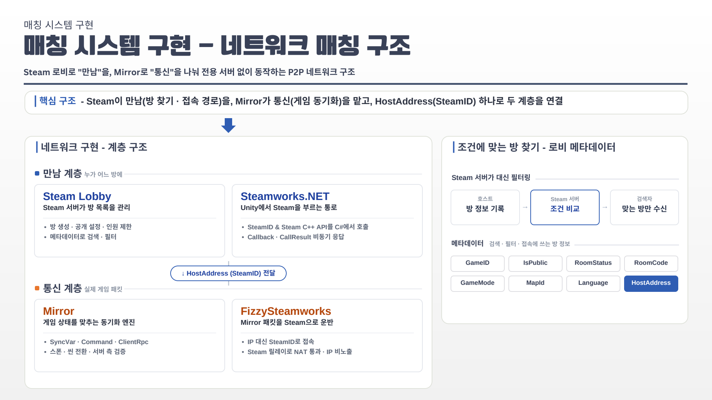
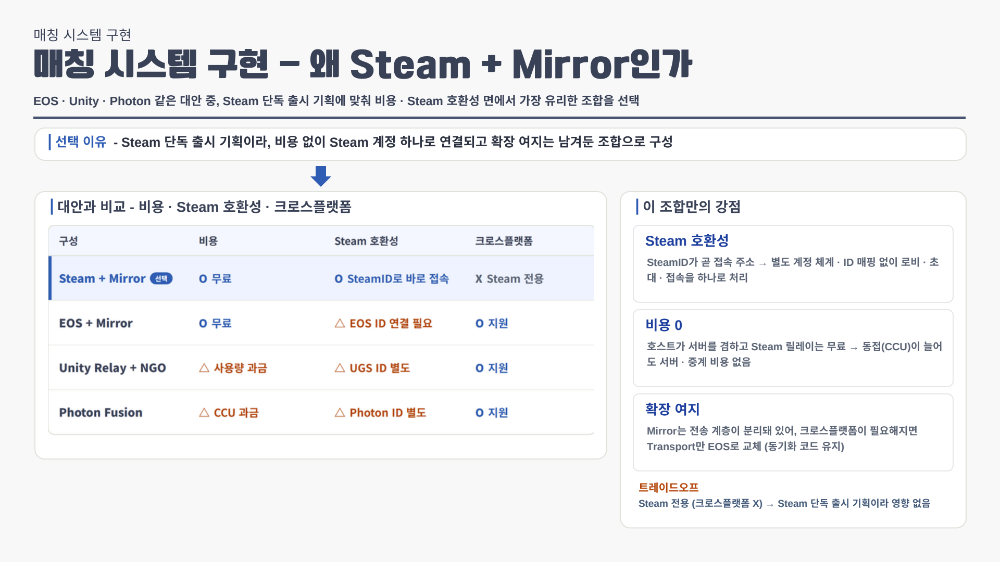
</details>

📂 **관련 코드** — [`LobbyManager.cs`](PixelChroma/Assets/02.%20Scripts/Core/Lobby/LobbyManager.cs) · [`RoomOption.cs`](PixelChroma/Assets/02.%20Scripts/Core/Lobby/RoomList/RoomOption.cs) · [`ChromaNetworkManager.cs`](PixelChroma/Assets/02.%20Scripts/Network/ChromaNetworkManager.cs)

---

## 2. 매칭 품질 설계

### 2-1. Quick Match — 단계적 조건 완화

> **조건을 4단계로 완화해 매칭 품질(핑 · 언어)과 대기 시간의 균형을 맞춘 자동 매칭**

<p align="center">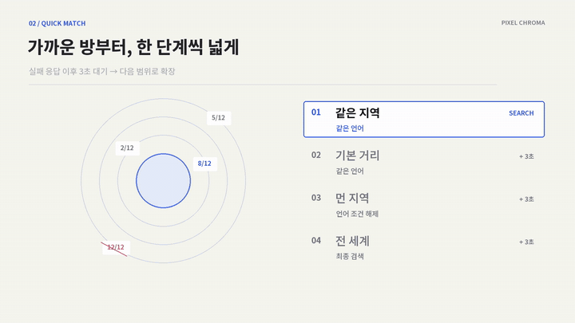</p>

| Phase | 0 | 1 | 2 | 3 |
| --- | --- | --- | --- | --- |
| **거리 필터** | Close | Default | Far | Worldwide |
| **언어 조건** | 같은 언어 | 같은 언어 | 해제 | 해제 |
| **진입 시점** | 즉시 | +3초 | +3초 | +3초 |

- **고정 조건은 끝까지 유지** — 우리 게임 · 공개 방 · 대기 중 · 빈자리 1개 이상은 모든 단계에 적용
- **인원 많은 방 우선** — `PickBestLobby`가 찾은 방 중 인원이 가장 많은 방을 고르고, 꽉 찬 방과 **미설치 창작마당 맵 방은 제외**
- **즉시 취소** — `UniTask` + `CancellationToken`으로 대기 중인 단계까지 바로 중단

> **결과** — 처음 약 6초는 가까운 지역 · 같은 언어의 방만 탐색하고, 4단계를 모두 돌면 실패를 안내해 무한 대기가 없습니다.

### 2-2. 로비 목록 — 유령방 대응

> **목록을 최신으로 유지하고 입장 실패를 즉시 복구해, 보이는 방과 실제 방 상태의 차이를 줄임**

<p align="center">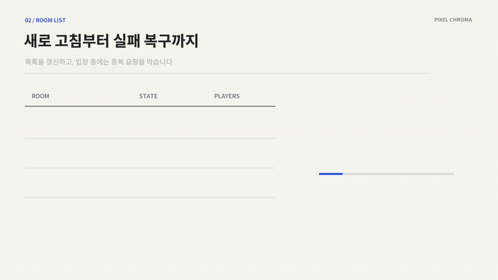</p>

- **방 상태 메타데이터** — 방 생성 · 로비 복귀 시 `Lobby`, 게임 시작 시 `InGame`으로 갱신. 목록 · 빠른 매칭 · 코드 입장이 같은 값으로 입장 가능 여부를 판단
- **게임 중인 방** — 목록엔 표시하되 입장 버튼만 비활성, 빠른 매칭은 검색 단계에서 제외, 코드 입장은 `RoomInGame`으로 거절
- **실패 사유 구분** — 로비 입장 실패(`JoinFailed`)와 Mirror 연결 실패(`ConnectFailed`)를 나눠 안내하고, 팝업 후 바로 재검색 · 자동 갱신 재개

> **결과** — 목록은 5초마다 갱신되고 입장 가능한 방이 위에 표시됩니다. 입장 중엔 목록을 잠가 중복 입장을 막고, 실패해도 새로고침 없이 바로 다른 방을 고를 수 있습니다.

<details>
<summary>📑 포트폴리오 슬라이드 보기 (Quick Match · 로비 목록)</summary>
<br>
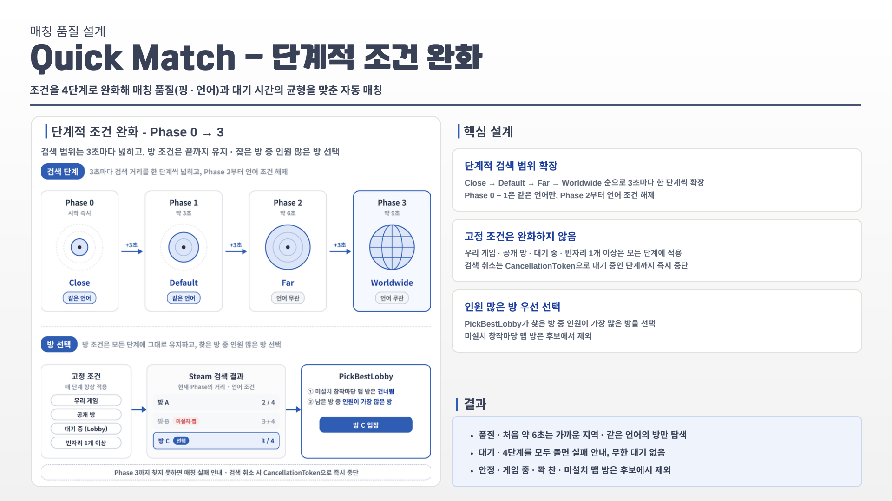
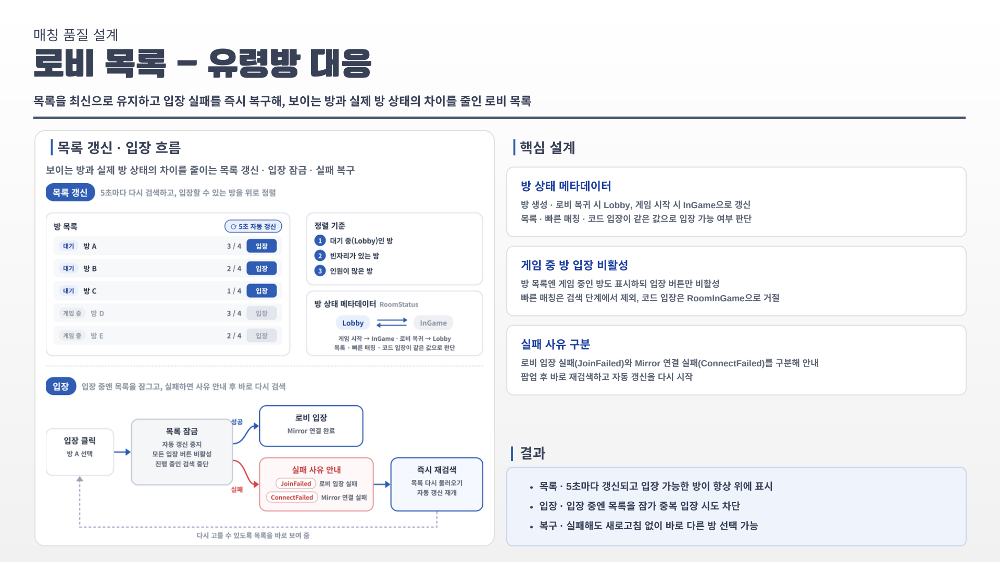
</details>

📂 **관련 코드** — [`QuickMatchSearcher.cs`](PixelChroma/Assets/02.%20Scripts/Core/Lobby/QuickMatch/QuickMatchSearcher.cs) · [`RoomListSearcher.cs`](PixelChroma/Assets/02.%20Scripts/Core/Lobby/RoomList/RoomListSearcher.cs)

---

## 3. 플레이어 색칠 — 저장 · 동기화

> **칠한 색은 폼별 마스크 1장에 저장하고, 다른 클라이언트에는 마스크가 아닌 입력만 보내 같은 연산으로 재현**

<table>
<tr>
<td width="50%">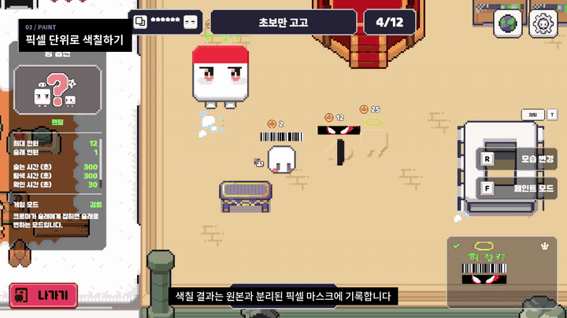</td>
<td width="50%">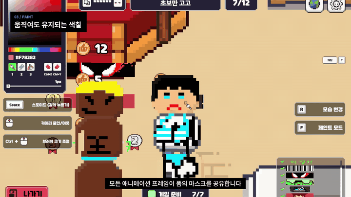</td>
</tr>
<tr>
<td align="center"><sub>픽셀 단위 색칠 — 원본과 분리된 마스크에 기록</sub></td>
<td align="center"><sub>모든 애니메이션 프레임이 같은 마스크를 공유</sub></td>
</tr>
<tr>
<td width="50%">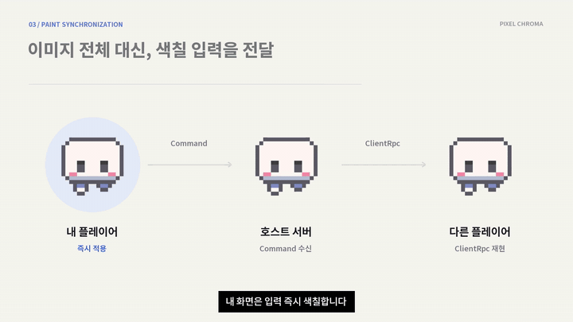</td>
<td width="50%">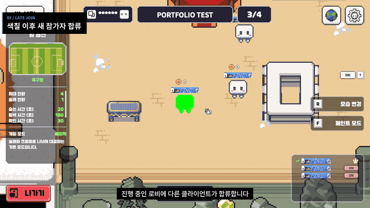</td>
</tr>
<tr>
<td align="center"><sub>이미지 대신 입력(좌표 · 색 · 크기)만 전달</sub></td>
<td align="center"><sub>늦게 들어온 참가자에게 현재 색칠 상태 복원</sub></td>
</tr>
</table>

| 설계 | 내용 |
| --- | --- |
| **폼별 페인트 마스크 1장** | 칠한 색은 원본 스프라이트와 분리된 마스크(`Color32[]`)에 칸 단위로 기록. 모든 애니메이션 프레임이 같은 칸 좌표를 공유해 폼마다 1장으로 처리 |
| **입력만 전송** | 브러시 · 지우개는 좌표 · 색 · 크기, 채우기는 시작 좌표 · 색만 `Command` → `ClientRpc`로 전송. 각 클라이언트가 같은 연산을 재실행해 동일한 마스크를 재현 |
| **늦은 입장 동기화** | 새로 들어온 클라이언트에만 호스트가 모든 폼의 칠해진 칸을 모아 전송. 메시지 크기 상한에 맞춰 **1000칸씩 나눠 `TargetRpc`** 로 전달 |

```csharp
// PlayerPaintCanvas.cs — 늦게 들어온 클라이언트에게 칠해진 칸만 청크로 전송
for (int i = 0; i < pixels.Length; i++)
{
    if (pixels[i].a == 0) continue;          // 칠하지 않은 칸은 건너뜀

    idxBuf.Add(i);
    colBuf.Add(pixels[i]);

    if (idxBuf.Count == RelayMaxCells)       // 1000칸 단위로 분할
    {
        TargetLoadSnapshot(conn, form.formType, firstChunk, idxBuf.ToArray(), colBuf.ToArray());
        firstChunk = false;
        idxBuf.Clear();
        colBuf.Clear();
    }
}
```

> **결과**
> - **저장** — 프레임별 텍스처 복사 없이 폼마다 마스크 1장만 유지
> - **전송** — 한 번 칠할 때 좌표 · 색 · 크기만 보내 수십 바이트로 동기화
> - **복원** — 늦게 들어오거나 폼을 바꿨다 돌아와도 칠한 모습 그대로

<details>
<summary>📑 포트폴리오 슬라이드 보기 (플레이어 페인트 저장 · 동기화)</summary>
<br>
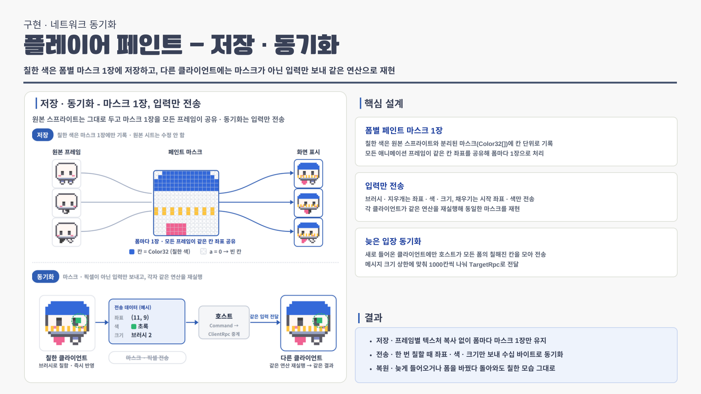
</details>

📂 **관련 코드** — [`PlayerPaintCanvas.cs`](PixelChroma/Assets/02.%20Scripts/Player/Common/PlayerPaintCanvas.cs) · [`PlayerPaintCanvas.History.cs`](PixelChroma/Assets/02.%20Scripts/Player/Common/PlayerPaintCanvas.History.cs) · [`PaintOps.cs`](PixelChroma/Assets/02.%20Scripts/Player/Common/PaintOps.cs)

---

## 4. 사용자 제작 픽셀 닉네임

> **60×12 픽셀로 그린 닉네임을 로컬에 저장하고, 접속 시 한 번만 서버에 올려 모든 클라이언트가 재사용**

<table>
<tr>
<td width="50%">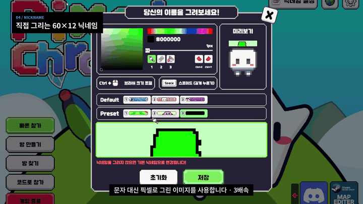</td>
<td width="50%">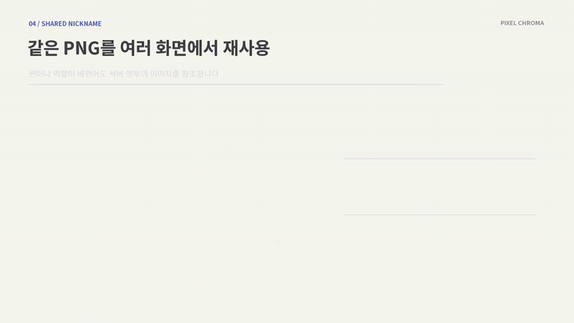</td>
</tr>
<tr>
<td align="center"><sub>문자 대신 직접 그린 60×12 픽셀 닉네임</sub></td>
<td align="center"><sub>한 번 받은 PNG를 채팅 · 점수판 · 인디케이터에서 재사용</sub></td>
</tr>
</table>

| 설계 | 내용 |
| --- | --- |
| **편집용 / 전송용 키 분리** | 프리셋 3개는 편집용, 메인 키 1개는 전송용으로 따로 저장. 어떤 프리셋을 편집해도 전송은 메인 키 하나만 읽음 |
| **접속당 1회 업로드** | 서버가 `connId`별 명부(`NicknameRegistry`)에 보관하고 `SyncVar`로 모든 클라이언트에 배포. 씬 전환 · 술래 전환 시엔 서버가 명부의 PNG를 새 오브젝트에 바로 입힘 |
| **받은 데이터 재사용** | 채팅 · 킬로그 · 점수판 · 인디케이터는 `netId`로 플레이어를 찾아 같은 PNG를 참조. 표시하는 곳이 늘어도 추가 전송 없음 |

> **결과**
> - **저장** — PNG + Base64로 `PlayerPrefs`에 보관해 게임을 다시 켜도 닉네임 유지
> - **전송** — 업로드는 접속당 1회, 씬 · 술래 전환 시에도 재업로드 없음
> - **재사용** — 표시하는 UI가 늘어나도 닉네임 이미지 추가 전송 없음

<details>
<summary>📑 포트폴리오 슬라이드 보기 (픽셀 닉네임 저장 · 동기화)</summary>
<br>
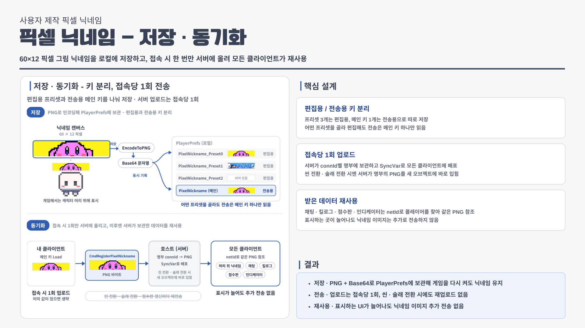
</details>

📂 **관련 코드** — [`PixelNicknameService.cs`](PixelChroma/Assets/02.%20Scripts/Core/Naming/PixelNicknameService.cs) · [`NicknameRegistry.cs`](PixelChroma/Assets/02.%20Scripts/Core/Naming/NicknameRegistry.cs) · [`PlayerBase.cs`](PixelChroma/Assets/02.%20Scripts/Player/Common/PlayerBase.cs) · [`UIPixelNicknameSetting.cs`](PixelChroma/Assets/02.%20Scripts/UI/Panels/Popup/NickName/UIPixelNicknameSetting.cs)

---

## 🔥 트러블슈팅 — 서버 지연으로 인한 발사 무시

> **클라이언트는 쿨타임을 지켜 쐈는데도 지연 편차 때문에 서버가 거부하던 발사를, 지연 허용 오차를 감안한 서버 판정으로 해결**

<table>
<tr>
<td width="50%">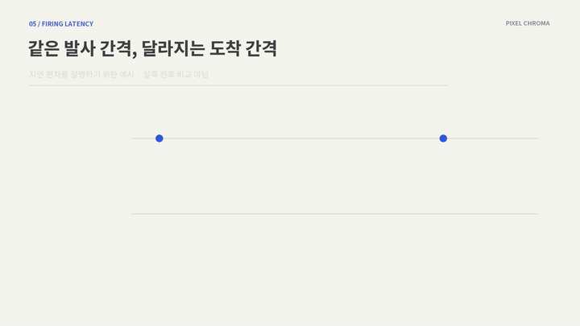</td>
<td width="50%">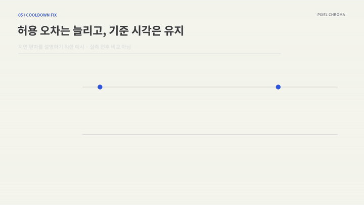</td>
</tr>
<tr>
<td align="center"><sub>문제 — 1.5초마다 쏴도 서버엔 더 짧은 간격으로 도착할 수 있음</sub></td>
<td align="center"><sub>해결 — 도착 편차는 허용하되 누적 발사 기준은 앞당겨지지 않게</sub></td>
</tr>
</table>

#### 🔍 문제 상황
술래가 쿨타임(1.5초)에 맞춰 물총을 쐈는데도 **간헐적으로 발사가 무시**되는 현상이 발생했습니다.

#### 🧪 원인 분석
- 자동 사격으로 현상을 재현하고 **서버의 발사 거부 로그**를 확인
- 클라이언트는 1.5초 간격으로 보냈지만, 네트워크 지연 편차로 서버 **도착 간격이 기존 허용 기준(1.40초)보다 짧아지는** 경우가 있었음
- 추가로 재충전을 `TargetRpc`로 따로 알려 **클라 1발 · 서버 0발**처럼 탄약 판정이 어긋나는 경우도 확인

#### 🛠 해결
| 해결 포인트 | 내용 |
| --- | --- |
| **허용 오차 0.10 → 0.25s** | 도착 간격 ≥ 쿨타임 1.50s − 허용 오차 0.25s 이면 승인. 지연 편차로 짧아진 간격도 정상 발사로 인정 |
| **판정 기준 시각 보정** | `다음 기준 = max(도착 시각, 이전 기준 + 1.50s)` → 허용 오차를 연달아 써도 연사 속도는 빨라지지 않음 |
| **탄약 판정 일치** | 서버도 `ServerTick()`에서 클라와 같은 주기로 탄약 회복. 재충전 `TargetRpc`를 제거해 불일치 제거 |

```csharp
// SeekerWaterGun.cs
private const float ServerCooldownGrace = 0.25f;   // 0.1 → 0.25

[Command]
private void CmdFireWaterGun(Vector2 targetPoint)
{
    // 지연 편차를 감안해 쿨타임 - 허용 오차 이상이면 승인
    if (Time.time - _lastServerFireTime < fireCooldown - ServerCooldownGrace)
        return;
    ...
    // 기준 시각은 '이전 기준 + 쿨타임'보다 앞당겨지지 않음 → 연사 속도 유지
    _lastServerFireTime = Mathf.Max(Time.time, _lastServerFireTime + fireCooldown);
    ...
}
```

#### ✅ 결과
- **발사** — 쿨타임을 지킨 발사는 지연 편차가 있어도 거부되지 않음
- **공정성** — 허용 오차를 넓혀도 연사 속도는 쿨타임 1.5초 그대로
- **확장** — 같은 판정을 Runner 도발 쿨타임에도 적용

<p align="center">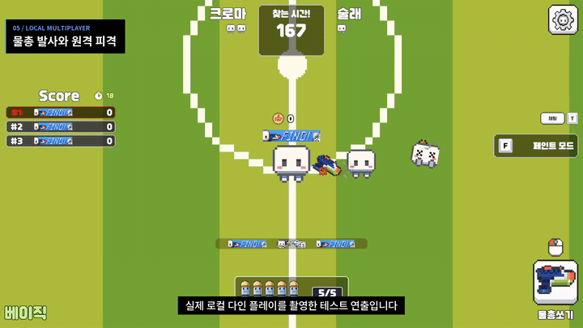</p>

<details>
<summary>📑 포트폴리오 슬라이드 보기 (서버 지연으로 인한 발사 무시)</summary>
<br>
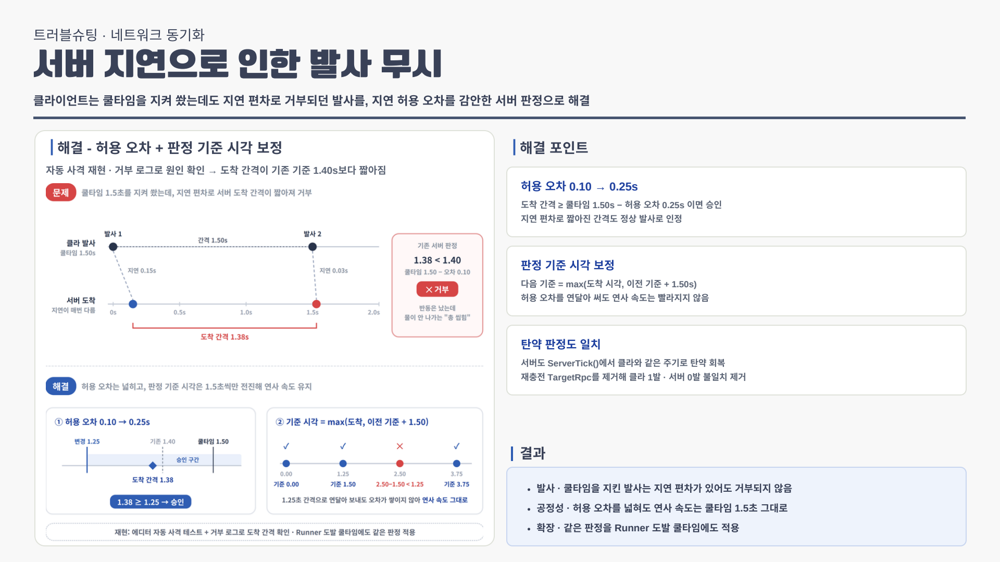
</details>

📂 **관련 코드** — [`SeekerWaterGun.cs`](PixelChroma/Assets/02.%20Scripts/Player/Seeker/SeekerWaterGun.cs)

---

## ➕ 그 외 구현 — 모드별 규칙 클래스 분리

게임 흐름은 공유하고, 표시 · 관전 · 인디케이터 판단은 모드별 규칙 클래스(`GameModeRule`)에 맡겨 기본 모드와 감염 모드를 분리했습니다.

<p align="center">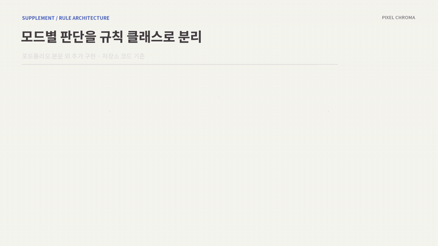</p>

📂 **관련 코드** — [`GameModeRule.cs`](PixelChroma/Assets/02.%20Scripts/Core/Mode/GameModeRule.cs) · [`BasicGameModeRule.cs`](PixelChroma/Assets/02.%20Scripts/Core/Mode/BasicGameModeRule.cs) · [`InfectionGameModeRule.cs`](PixelChroma/Assets/02.%20Scripts/Core/Mode/InfectionGameModeRule.cs) · [`GameModeRuleFactory.cs`](PixelChroma/Assets/02.%20Scripts/Core/Mode/GameModeRuleFactory.cs)

---

## 🧰 기술 스택

| 분류 | 사용 기술 |
| --- | --- |
| **Engine** | Unity 6 (6000.3.11f1), URP |
| **Language** | C# |
| **Network** | Mirror, FizzySteamworks (Steam Networking Transport) |
| **Platform / SDK** | Steam, Steamworks.NET (Steam Lobby · 친구 초대 · 창작마당) |
| **Async** | UniTask |
| **UI / Resource** | TextMeshPro, Addressables |
| **Collaboration** | Git, GitHub |

<br>

<div align="center">

**최준영 · Unity Client Developer**
📧 juny2221@gmail.com · ▶ [YouTube](https://www.youtube.com/channel/UCMoIuWbEUPRG-8-CIZpd6cQ)

</div>
